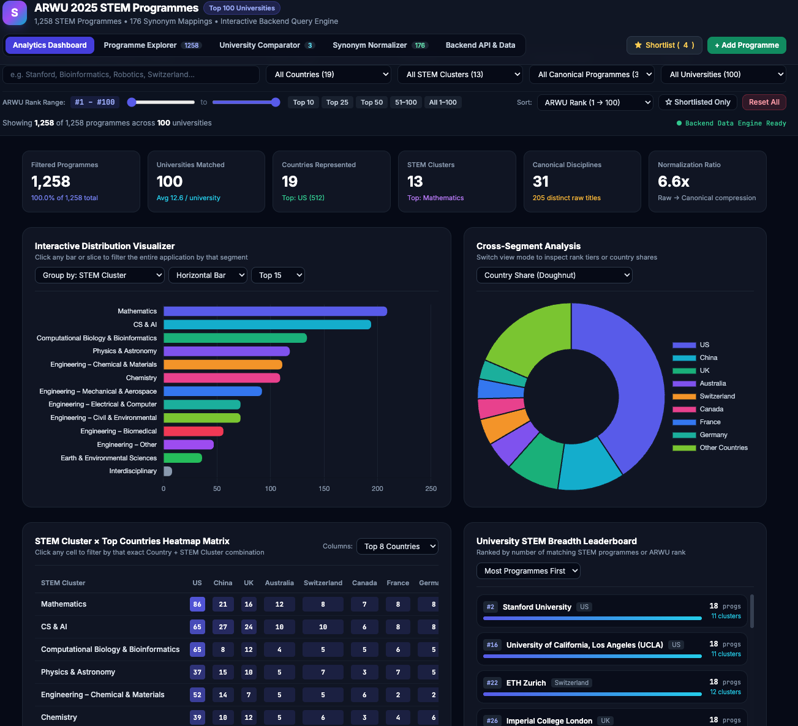
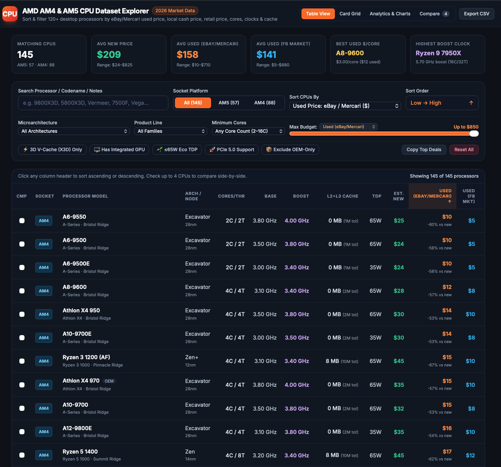

# Datasites
Data Web Apps built with Gemini, Google Sites, open source dataset, data mining

## ARWU 2025 STEM Programmes
An interactive datasite for most popular STEM designated majors in top 100 university of the world

• Model Name: Gemini 4 Argon (gemini-4-argon)

• Release Date: October 13, 2026

Dataset:
https://www.kaggle.com/datasets/mariaatamanova/stem-programmes-at-the-top-100-universities-2025

Web App link:
https://sites.google.com/view/stemdegrees10-2026

## AMD AM4 & AM5 CPU Dataset Explorer
2026 Market Data from open web, for AM4 and AM5 CPUs based on various specs and details as well as new and used pricing

• Model Name: Gemini 4 Argon (gemini-4-argon)

• Release Date: October 13, 2026

Data from open web

Web App link:

https://sites.google.com/view/amd4and5cpupricing

